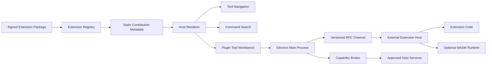

# 插件系统 v2 设计

> 状态：设计基线
> 更新日期：2026-11-10
> 适用范围：Electron 外部插件、工具注册、命令搜索、扩展宿主和插件权限

## 术语和命名规则

| 中文名称 | English / 标识 | 职责与排除范围 |
| --- | --- | --- |
| 内置扩展 | First-party Extension | 随应用构建、由项目源码审查的扩展；可以使用仓库内 SDK，不代表第三方代码安全。 |
| 外部扩展 | External Extension | 用户安装的签名扩展包；不能直接提供 Vue 组件、HTML、CSS 或主窗口 DOM。 |
| 扩展宿主 | Extension Host | 运行外部扩展代码的独立进程或受限运行时；负责激活、命令执行、取消和清理。 |
| 宿主渲染器 | Host Renderer | IT Tools 的 Vue 渲染器；负责工具页面、表单、结果、导航和命令搜索。 |
| 贡献点 | Contribution Point | 扩展清单声明的工具、命令、设置和数据提供者。它只描述接入位置，不直接授予权限。 |
| 工具工作台 | Plugin Tool Workbench | 宿主提供的声明式工具页面。它使用统一的布局、主题、控件、错误和结果样式。 |
| 能力代理 | Capability Broker | 主进程中的权限检查和执行边界。它只执行已声明、已支持并已批准的能力。 |
| RPC | External Extension RPC | 宿主与扩展宿主之间的版本化 JSON 消息通道；不是任意 Electron IPC 转发。 |
| 受限计算插件 | WASM Plugin | 运行纯计算、解析、转换和校验逻辑的非 WASI WASM 插件；不负责复杂桌面界面。 |

## 1. 设计目标

插件应像 VS Code 和 Zed 的扩展一样接入平台：扩展先通过清单声明身份、贡献点、激活条件和能力；宿主在不执行扩展代码时完成发现、导航和搜索注册；用户真正打开工具或执行命令时，扩展宿主才按需激活。

工具界面由 IT Tools 统一渲染。外部扩展只返回结构化的工具元数据、输入数据、命令结果和状态通知。这样插件工具与内置工具使用同一套 `toolLayout`、主题、键盘操作、响应式布局和错误处理。

扩展代码与主窗口分离。外部扩展不能取得主窗口的 preload、Vue 实例、DOM、Node 文件系统、任意 Shell 或其他插件的数据。所有宿主能力都通过能力代理和版本化 RPC 暴露。

Electron `utilityProcess` 只提供进程和崩溃隔离，本身不会限制 Node 对文件、网络或子进程的访问。签名与进程隔离都不能代替能力限制。因此，在具备可验证的系统沙箱之前，`process` 类型只保留包格式和传输骨架，不加载第三方 Node 入口。受限 WASM 执行路径也必须先验证导入、内存、超时和进程清理边界，才能开放执行。

插件系统采用分层运行方式：

1. 内置扩展继续使用当前的第一方 `FirstPartyExtensionHost`，保持最佳性能和完整 UI 能力。
2. 外部扩展优先使用独立扩展宿主和 RPC，适合需要命令、工具和宿主服务的第三方功能。
3. 纯计算逻辑使用非 WASI WASM 运行时，限制文件、网络和进程访问，不承载复杂界面。

## 2. 总体结构



`Registry` 只保存已验证的静态元数据。`Host Renderer` 不加载外部实现代码。`Main Process` 负责扩展宿主进程、RPC 请求和能力代理的边界。箭头表示单向数据或控制流；能力代理的执行结果沿 RPC 返回宿主渲染器。

## 3. 外部扩展清单 v2

外部扩展 v2 使用独立的主版本，避免把 HTML 页面入口与新的扩展宿主协议混在一起。贡献清单只包含可审查的静态数据：

```json
{
  "formatVersion": 2,
  "id": "org.example.json-tools",
  "name": "JSON Tools",
  "version": "1.0.0",
  "apiVersion": { "minInclusive": "2.0.0", "maxExclusive": "3.0.0" },
  "activationEvents": [
    "onTool:org.example.json-tools/summary",
    "onCommand:org.example.json-tools/summarize"
  ],
  "requestedCapabilities": [],
  "contributions": {
    "tools": [{
      "id": "org.example.json-tools/summary",
      "title": "JSON summary",
      "description": "Summarize a JSON document.",
      "keywords": ["json", "summary"],
      "categoryId": "development",
      "dataProcessing": "memory-only",
      "offline": "available",
      "capabilities": [],
      "inputs": [
        { "id": "input", "kind": "text", "multiline": true, "label": "JSON input", "required": true, "maxLength": 16384 }
      ],
      "output": { "kind": "json" }
    }],
    "commands": [{
      "id": "org.example.json-tools/summarize",
      "title": "Summarize JSON",
      "description": "Summarize a JSON document.",
      "keywords": ["json", "summary"],
      "toolId": "org.example.json-tools/summary"
    }]
  }
}
```

宿主校验以下内容后才注册贡献点：插件 ID、版本、API 范围；贡献 ID 是否属于插件命名空间；工具字段类型、数量、长度和结果类型；命令、工具和激活事件是否一一对应；能力是否属于已知目录。工具元数据必须完整存在于签名清单中，不能等扩展代码启动后再改变导航和搜索结构。

清单可以通过 `contributions.settings` 声明插件自己的非秘密标量设置。设置 ID 使用插件命名空间，类型为 `string`、`number` 或 `boolean`，并提供类型匹配的 `defaultValue`。字符串可以声明 `maxLength`，数字可以声明 `integer`、`minimum` 和 `maximum`；宿主限制最多 64 个设置，字符串默认长度最多 4,096 个字符。工具使用 `settings` 数组引用设置 ID；只要存在引用，工具就必须在 `capabilities` 中声明 `settings.read`，并且该能力也必须出现在清单的 `requestedCapabilities` 中。校验器拒绝重复或未声明的引用、越界默认值、错误类型和秘密字段。桌面设置页读取这些声明并保存插件命名空间中的非秘密值；工具运行时只接收自己引用的设置快照，缺失或无效的持久化值回退到清单默认值。

运行时入口和签名属于安装包封套，而不是渲染器使用的贡献清单。安装器单独校验 `runtime`、`entrypoint`、文件哈希和 Ed25519 签名，再把通过校验的贡献清单交给本节的静态注册器。执行前还须重新核验安装目录中每个签名文件的哈希。这样渲染器不需要信任入口脚本，也不会把安装包路径暴露给工具页面。

### v2 WASM 包打包

开发者可以复用已有的 v2 静态清单和 `.wasm` 文件。`plugin:pack:v2` 不编译插件，也不生成清单。输入清单只包含本节定义的贡献声明；打包器会在签名封套中加入 `runtime: "wasm"`、入口路径、文件 SHA-256 和 Ed25519 签名。v2 清单的 `apiVersion` 必须包含当前宿主 API `2.0.0`。

```sh
pnpm run plugin:keygen --key-id example-publisher --output-directory "$HOME/.config/it-tools/plugin-keys"
pnpm run plugin:pack:v2 \
  --manifest ./plugin.manifest.json \
  --wasm ./build/plugin.wasm \
  --entrypoint extension.wasm \
  --private-key "$HOME/.config/it-tools/plugin-keys/example-publisher.private.pem" \
  --key-id example-publisher \
  --output ./artifacts/example-plugin.itxs
```

`--manifest` 指向不含 `runtime`、`entrypoint`、`files` 和 `signature` 的 v2 静态清单。`--wasm` 指向开发者已有的 WASM 文件；`--entrypoint` 指定它在安装包内的相对路径。当前打包命令只收录这一份 WASM 文件，不收录额外资源。输出包使用与 v1 相同的确定性未压缩 ZIP 容器和 `.itxs` 扩展名，但采用 `IT Tools Electron Plugin Package v2` 签名域。

在编译和签名前，可以运行只读校验命令：

```sh
pnpm run plugin:validate:v2 --manifest ./plugin.manifest.json
```

该命令只读取并校验静态清单，输出插件 ID 和版本。它不读取私钥，不读取或执行 WASM，不创建安装包。清单不能包含 `runtime`、`entrypoint`、`files` 或 `signature`；这些字段只由 `plugin:pack:v2` 加入签名封套。

打包器调用 `validateExternalPluginV2Manifest` 检查完整静态清单和 API 兼容范围，再检查入口路径、文件大小和密钥类型。它为 WASM 文件计算小写十六进制 SHA-256 并签名，但不会编译或执行 WASM。安装器在安装时会再次校验 v2 清单、可信签名者和所有文件哈希；扩展宿主在执行时再检查 WASM ABI 和模块资源。签名密钥必须存放在仓库外，输出文件已存在时命令会失败且不会覆盖。

## 4. 宿主渲染的工具模型

v2 首先支持有限的声明式工具字段：`text`、`textarea`、`number`、`boolean` 和 `select`。字段包含稳定 ID、标签、说明、占位符、是否必填、默认值和边界值。数字字段可设置 `integer: true`，要求工作台只提交安全整数；未设置时，工作台接受有限的整数或浮点数。`step` 只设置数字控件的加减步进量，不限制可提交值；需要整数输入的插件必须声明 `integer: true`。结果支持 `text`、JSON 和宿主统一渲染的 `table`。表格由 `columns` 和 `rows` 组成，列 ID 只能使用小写字母、数字、下划线和连字符；每行必须与列数相同。宿主最多接受 64 列、1,000 行和 4,096 字符单元格，不接受 HTML、组件或自定义渲染字段。

宿主使用 `PluginToolWorkbench` 渲染这些字段。组件负责：

- 使用 `toolLayout` 和共享主题值显示标题、说明、输入区、操作按钮和结果区。
- 在提交前执行字段类型、必填项、长度、数值范围和整数约束校验。
- 通过 `executeCommand` RPC 发送结构化输入。
- 显示运行中、取消、失败和结果状态。
- 在路由离开、窗口关闭或插件停用时取消未完成请求。

外部扩展不能返回 HTML、CSS、Vue 组件、任意脚本或可执行渲染模板。表格使用宿主共享表格组件，支持列头、空行、长值和窄窗口横向滚动；宿主不启用插件排序、筛选或自定义单元格模板。树、日志和文件选择仍需先增加宿主审核过的字段和结果类型。复杂自定义界面不进入 v2 的默认贡献模型。

## 5. 发现、注册和按需激活

生命周期固定为：

```text
discover -> validate -> register -> activate -> ready
                                      |
                         timeout / crash / protocol error
                                      v
                                  disable -> diagnose -> restart
```

1. `discover` 扫描插件安装目录和市场来源记录，不执行插件代码。
2. `validate` 检查签名、版本、资源、贡献点和能力声明。
3. `register` 将静态工具元数据加入统一 `ToolRegistry`，同时更新左侧导航和命令搜索。
4. `activate` 在打开工具或执行命令时启动扩展宿主，并完成 RPC 握手。
5. `ready` 后允许执行已批准的命令和数据提供者。
6. 超时、崩溃、协议错误和资源超限会记录诊断、清理 RPC、撤销能力并标记插件不可用。一个插件失败不能阻塞内置工具或其他插件。

v2 包的安装状态与运行状态分开管理。包仍为 `installed` 时，宿主会在内存中记录 `runtimeStatus`（`ready` 或 `unavailable`）和可重试的 `runtimeFailureCode`（`transport-error`、`extension-failed`、`timeout` 或 `protocol-error`）。运行失败不会删除工具导航或命令搜索索引；工作台显示插件 ID、版本、稳定错误码和 `Retry` 按钮。命令成功后清除同一包的故障状态。用户取消、权限拒绝和 `invalid-request` 不会标记插件不可用。

工具路由统一指向宿主 `ToolRoutePage` 和 `PluginToolWorkbench`。插件停用或卸载后，工具导航、收藏和命令搜索都删除对应贡献；旧路由显示明确的不可用状态，不打开残留页面。

## 6. RPC 接口约定

每条消息包含协议版本、请求 ID、插件 ID、方法和 JSON 负载。主进程验证消息大小、字段集合、请求 ID、插件身份和当前会话，然后再转发到扩展宿主。

```json
{
  "protocolVersion": 1,
  "requestId": "req-1",
  "pluginId": "org.example.json-tools",
  "method": "executeCommand",
  "payload": {
    "commandId": "org.example.json-tools/summarize",
    "input": { "input": "{\"ok\":true}" }
  }
}
```

响应只允许成功结果或稳定错误码：`invalid-request`、`unsupported-method`、`not-active`、`permission-denied`、`payload-too-large`、`too-many-requests`、`timeout`、`cancelled`、`transport-error`、`extension-failed` 和 `disposed`。宿主发现扩展返回值不符合工具结果协议时，在包诊断中记录 `protocol-error`。

每个请求都设置超时、取消入口和响应大小上限。宿主限制并发数、自动重启次数和未完成请求数量。普通 `cancel` 只取消目标请求；同步 WASM 计算需要终止其扩展进程，同一进程的其他活动请求也会失败，其他插件会话不受影响。关闭或停用时先拒绝新请求，再取消活动请求，最后销毁传输资源。

### WASM 纯计算接口

独立的实验执行器使用 UTF-8 JSON 请求 `{ "commandId": "...", "input": ... }`。批准 `runtime.info` 后，该次请求额外包含 `capabilityContext.runtimeInfo`，其中 `platform` 是操作系统标识，`appVersion` 是应用版本。模块只能导入宿主提供的 `env.memory`，并且只能导出 `alloc(size)`、`execute(pointer, length)` 和 `free(pointer, length)`。`execute` 返回的 64 位值以高 32 位表示结果指针，低 32 位表示结果字节长度；结果必须是 UTF-8 JSON。宿主内存初始为 16 页，上限为 256 页；模块上限为 16 MiB，请求和结果各不超过 16 KiB。模块不能自建内存或表，也不能导入 WASI、文件、网络或其他宿主函数。

WASM 执行器已经接入独立扩展宿主，支持纯计算命令和经用户批准使用 `runtime.info` 的命令。WASM 调用是同步的；主进程在超时或取消后请求终止承载计算的 utility process，并在进程确认退出前阻止新扩展进程启动。首版全局最多运行一个扩展进程。内存上限和导入检查不限制 V8 编译、代码生成或进程总内存；Electron 没有跨平台的进程总内存硬配额接口，因此不能承诺抗恶意资源耗尽。

## 7. 能力、存储和故障边界

能力按用途拆分，例如 `runtime.info`、`clipboard.write`、`settings.read`、`settings.write`、`filesystem.workspace`、`network` 和 `process.spawn`。清单声明、宿主支持和用户批准是三个集合。请求能力不会自动获得批准，工具执行时使用“工具声明能力”与“用户已批准能力”的交集。

当前 v2 执行能力支持 `runtime.info` 和只读 `settings.read`，支持列表由共享协议常量提供给主进程策略和桌面管理器。设置值由宿主设置页编辑并保存到插件专属命名空间；每次命令运行前，主进程只读取当前工具引用的设置，并将经过类型和边界校验的快照发送到扩展宿主。管理器会显示包请求的能力和宿主支持状态；使用 `runtime.info` 或 `settings.read` 的命令都需要每次确认。用户拒绝后不启动命令；批准只对当前命令有效，下次运行仍需确认。渲染进程不能指定或修改运行时信息或设置快照。`settings.write`、其他 v2 能力请求会被拒绝。

插件设置保存在插件专属命名空间。v2 宿主设置页负责编辑值，v2 工具只能通过本次授权的 `settings.read` 快照读取自己声明的设置；当前不提供 v2 插件写入入口。legacy v1 插件的版本化设置 API 仍受原有能力代理约束。插件不能直接读写应用 SQLite、配置文件、凭据或其他插件目录。文件、网络和进程能力必须分别申请，并由能力代理执行入口层校验。

扩展宿主崩溃时，主进程保留工具索引但将工具标记为不可用；用户可以重启或禁用插件。重启达到上限后停止自动重试，保留诊断信息，避免主窗口进入循环故障。

## 8. 兼容策略

现有 v1 HTML/webview 插件保留为 legacy 兼容路径，用于迁移已安装包和读取旧设置。legacy 包不进入 v2 的统一声明式工具注册，除非完成清单转换和显式迁移。目前设置页分别提供 v1 和 v2 安装入口；迁移工具应生成新的 v2 清单和签名包，不把旧 HTML 页面伪装成原生工具。

旧版 `ExternalPluginTool.page.vue`、`createPluginEmbeddedWindow` 和 `it-plugin://` 页面服务属于 legacy 运行时。它们不能成为 v2 工具工作台的依赖。v2 的路由、索引、搜索和权限逻辑应与 legacy 适配器分开。

## 9. 分阶段实施和验收

当前代码已经完成 v2 清单校验（包括设置声明）、签名包静态安装、独立安装目录扫描、工具和命令注册、宿主工作台、设置页的插件包管理和设置编辑，以及 WASM 命令执行。宿主工作台提供运行中状态和显式取消操作，并通过 `AbortSignal` 连接到扩展宿主的取消协议。文本、JSON 和受限表格结果由宿主统一渲染。主进程在执行前复核签名文件；扩展宿主再次核验 WASM 入口哈希。`runtime.info` 和 `settings.read` 按次请求用户批准；`settings.write`、其他能力、`process` 运行时和数据提供者仍未开放。

### 阶段一：宿主渲染和静态注册

完成 v2 类型、清单校验、`PluginToolWorkbench`、工具索引适配器、运行时注册表和命令搜索静态注册。使用一个声明式 JSON 工具样例验证导航、搜索、路由、窄窗口、主题和键盘操作。

### 阶段二：扩展宿主 RPC

完成独立扩展宿主传输的启动、握手、取消、退出清理和 JSON 响应过滤，并接入已安装包的静态清单和 WASM 命令。继续验证扩展崩溃后的恢复、数据读取和能力代理。主进程不能转发未知方法或超出大小的负载。

### 阶段三：权限和设置隔离

接入能力代理、插件专属设置和诊断记录。验证未声明、未支持和未批准能力全部被拒绝；停用、卸载、重启和版本切换清理活动请求与授权。

### 阶段四：WASM 计算插件

为纯计算、解析、转换和校验提供不导入 WASI 的 WASM 运行时。已验证输入输出边界、线性内存上限、超时、签名和安装后篡改；继续验证升级、回滚、禁用及目标平台资源控制。

每个阶段都使用独立提交和对应回归。回退只撤销该阶段的 v2 适配器、协议和测试，不删除用户安装数据、设置或 legacy 迁移记录。

## 参考

- [Ramag 插件机制：借鉴 VS Code 与 Zed，构建可扩展的桌面工具平台](https://blog.likanug.top/posts/ramag-plugin-architecture-vscode-zed)
- [VS Code Extension Host](https://code.visualstudio.com/api/advanced-topics/extension-host)
- [VS Code Extension Manifest](https://code.visualstudio.com/api/references/extension-manifest)
- [Zed Developing Extensions](https://zed.dev/docs/extensions/developing-extensions)
- [Zed Extension Capabilities](https://zed.dev/docs/extensions/capabilities)
